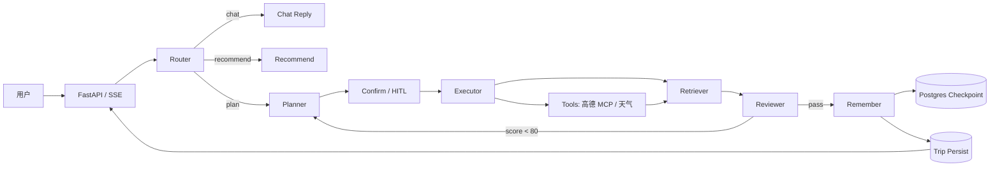

# StarTrip

[](https://github.com/chen-249074185/StarTrip/actions/workflows/ci.yml)


面向自助出行用户的 AI 行程规划工作流：自然语言需求 → 多日可编辑行程。

> 说明：本仓库为整理归档版本，提交历史自 2026.10 起（项目开发周期 2026.07–2026.10）。

系统用 LangGraph 状态图编排「路由 → 规划 → 人工确认 → 工具执行 → RAG 检索 → 审查回环 → 记忆/落库」，调度高德 MCP 与天气服务，结合 pgvector 攻略知识库，输出带评分和约束校验的行程，并通过 SSE 流式返回过程与结果。

---

## 亮点

- **可回环的工作流**：Reviewer 从时间衔接、路线合理性、偏好匹配、预算、内容丰富度 5 个维度打分；低于 80 分带 feedback 回到 Planner，最多 3 次。
- **混合检索**：pgvector dense（余弦）+ ILIKE sparse（关键词）+ RRF 融合；查询改写拆成多路 dense query + keywords，固定注入 topK=5。
- **工具治理**：高德 MCP（POI / 路线 / 天气）+ 天气服务；超时、指数退避重试、三态熔断、失败隔离，单个工具挂掉不拖垮整张图。
- **HITL + 断点续跑**：执行前 `interrupt` 让用户确认/编辑任务清单；Postgres Checkpoint 支持暂停、恢复、多轮记忆。
- **SSE 流式**：`progress / node / interrupt / result / done / error` 事件；前端行程卡片 + 高德地图可视化。
- **可观测与评测**：OTel + Jaeger 记录节点/工具/LLM span；独立 LLM-as-judge + golden set 离线评测。

---

## 架构


上图是整体架构；下图是 LangGraph 工作流：



### 图节点

| 节点 | 职责 |
|---|---|
| `router` | 判断 chat / recommend / plan，抽取目的地与季节 |
| `planner` | 生成工具调用清单（首次或带 feedback 重规划） |
| `confirm` | HITL：执行前暂停，等待用户确认/编辑 |
| `executor` | 并发执行工具，超时/重试/熔断/失败隔离 |
| `retriever` | 查询改写 → dense + sparse → RRF → topK 攻略 |
| `reviewer` | 生成行程 + 5 维评分 + feedback；不合格回环 |
| `remember` | 写入多轮记忆 / 摘要 |
| `persist` | 行程落库，支持 `/api/trips` 查询 |

---

## 技术栈

| 层 | 选型 |
|---|---|
| Web | FastAPI + SSE |
| 编排 | LangGraph StateGraph（条件回环 + Checkpoint） |
| LLM | DeepSeek `ds-4.1-flash` |
| Embedding | DashScope `text-embedding-v3`（1024 维） |
| 工具 | 高德 MCP（POI / 路线 / 周边 / 天气）+ 天气服务 |
| 向量库 | PostgreSQL + pgvector |
| 缓存 / 偏好 | Redis |
| 前端 | Vue 3 + Vite + 高德 JS API |
| 可观测 | OpenTelemetry + Jaeger |
| 评测 | LLM-as-judge + golden set |
| 测试 | pytest + httpx + ruff |
| 部署 | docker-compose（Postgres + Redis + Jaeger + app） |

> 当前实现**没有**使用 Milvus、Kafka、布隆过滤器、BM25、Rerank。原因见「技术选型取舍」。

---

## 评测结果

### 检索层（12 条固定集）

| 指标 | 值 |
|---|---:|
| cases | 12 |
| Recall@5 | 1.0 |
| MRR | 1.0 |
| key_fact_coverage | 1.0 |
| no_answer_false_positive_rate | 0.0 |
| avg_latency_ms | 852.1 |

### 端到端 smoke（1 条）

| 指标 | 值 |
|---|---:|
| factual_consistency | 0.6 |
| grounded_rate | 0.8 |
| answer_coverage | 0.6 |
| format_valid_rate | 1.0 |
| constraint_include_rate | 1.0 |
| avg_review_score | 88.0 |
| avg_latency_ms | 12510.7 |

### 测试

```text
73 passed, 3 skipped
ruff: All checks passed
```

> 说明：12 条检索集偏小、关键词与知识库重合度高，1.0 的指标偏乐观；端到端只跑了 1 条 smoke。评测方法、指标定义和下一步扩集计划见 [`docs/EVAL.md`](docs/EVAL.md)。

---

## 可靠性

| 能力 | 实现 |
|---|---|
| 超时 | LLM / Embedding / 工具分别配置超时 |
| 重试 | tenacity 指数退避 + 抖动，只重试 429 / 5xx / 超时 / 连接失败 |
| 熔断 | 连续失败 N 次打开，冷却后半开探测，成功闭合 |
| 失败隔离 | `executor` 并发执行，单工具失败返回 `{"error": ...}`，不中断整图 |
| 降级 | Planner/Reviewer LLM 失败走 fallback；Redis 不可用时偏好 GET 返回空、POST 503 |
| 断点续跑 | LangGraph `PostgresSaver`，`thread_id = user_id:session_id` |
| 可观测 | OTel span：request → node → tool / LLM；Jaeger 查看耗时与异常 |

---

## 安全与限制

- JWT 鉴权可选（`AUTH_ENABLED=true`），Checkpoint 按 `user_id:session_id` 隔离；默认关闭以保留 demo 体验。
- API Key 全部走 `.env`，不落库。
- 工具来自固定注册表，但**没有完整的 Prompt Injection / 内容安全防护**；外部 POI 文本只作为证据，不作为指令。
- 单实例设计：Postgres + Redis + 本地进程；没有 Kafka / 多副本 / 分布式锁。
- 评测集小、无 rerank、sparse 为 ILIKE 关键词；这些是当前已知短板。

---

## 快速开始

### Docker（推荐）

```bash
cp .env.example .env    # 填 DEEPSEEK_API_KEY / DASHSCOPE_API_KEY / AMAP_KEY
docker compose up -d --build
```

首次启动后构建知识库：

```bash
docker compose exec -T app python -m scripts.build_kb
```

打开 <http://localhost:8000>；Jaeger UI <http://localhost:16686>。

### 本地开发

```bash
python -m venv .venv
.\.venv\Scripts\Activate.ps1      # Windows
pip install -r requirements.txt
cp .env.example .env
docker compose up -d postgres redis jaeger
python -m uvicorn app.main:app --reload --port 8000
```

前端开发模式：`cd frontend; npm run dev`（5173，代理到 8000）。

### 测试与评测

```bash
pytest -q
ruff check app scripts tests

# 检索层评测
python -m scripts.eval_retrieval --md reports/retrieval.md

# 端到端评测（需要 PG、知识库、LLM/高德 Key）
python -m scripts.run_eval --md reports/eval.md
```

---

## 技术选型取舍

- **为什么 LangGraph 状态图，而不是 while 循环 / 纯 ReAct**：需要条件回环、HITL 暂停、Checkpoint 恢复和节点级可观测；图结构让失败定位和单测更直接。
- **为什么 pgvector，而不是 Milvus**：当前是单机、攻略语料规模有限，Postgres 同时承担业务表 + 向量 + Checkpoint，少一个中间件；规模上来再迁 Milvus。
- **为什么 sparse 用 ILIKE，而不是 BM25**：中文分词需要 zhparser/pg_jieba 等额外依赖；ILIKE 零依赖，作为 dense 的补充够用，代价是语义弱。
- **为什么没有 Kafka**：当前是请求-响应 + SSE，单实例；异步任务用 FastAPI 后台任务/队列即可。没有真实吞吐/积压数据，Kafka 是过度设计。
- **为什么没有布隆过滤器**：POI/城市 key 数量有限，缓存穿透风险低；没有真实拦截量，不值得引入。
- **为什么没有 rerank**：先保证 dense + sparse + RRF 基线可评测；rerank 需要额外模型/延迟预算，放在 Roadmap。
- **为什么 HITL 默认开启**：行程规划是高风险生成任务，执行前让用户确认工具清单，避免“直接跑一堆无效调用”。

---

## 目录结构

```text
app/
  main.py              FastAPI 入口 + SSE
  graph.py             LangGraph 图定义 + 条件边
  state.py             TripState
  llm.py               DeepSeek / Embedding + 重试/熔断
  resilience.py        超时 / 重试 / 熔断 / 降级
  observability.py     OTel 初始化 + 节点 span
  memory.py            多轮记忆 / 摘要
  prefs.py             Redis 偏好
  auth.py              JWT（可选）
  nodes/               router / planner / confirm / executor / retriever / reviewer / recommend / chat_reply / remember / persist
  rag/                 query rewrite + dense/sparse/RRF
  tools/               高德 MCP + 天气
  eval/                LLM-as-judge + 指标聚合
  db/                  Postgres / Redis / Checkpoint / Trips / Users
scripts/               build_kb / run_eval / eval_retrieval / create_user / mock_llm_server
tests/                 pytest
docs/                  design / decisions / DEVLOG / API 契约 / EVAL
frontend/              Vue 3 + Vite + 高德地图
kb/                    50+ 城市攻略 Markdown
docker-compose.yml
```

---

## 文档

- [`docs/design.md`](docs/design.md)：系统设计
- [`docs/decisions.md`](docs/decisions.md)：技术决策记录（ADR）
- [`docs/EVAL.md`](docs/EVAL.md)：评测方法与结果
- [`docs/接口契约.md`](docs/接口契约.md)：REST / SSE 契约
- [`docs/DEVLOG.md`](docs/DEVLOG.md)：开发记录

---

## Roadmap

- [ ] 评测集扩到 50+ 条，加入改写 query、no-answer、跨城市干扰
- [ ] 混合检索 A/B：dense-only vs dense+sparse vs +rerank
- [ ] BM25 / rerank 实验（有指标再上线）
- [ ] Prompt Injection / 工具白名单 / 内容安全
- [ ] CI 增加 Postgres + Redis 集成测试
- [ ] 多实例部署与异步任务队列（有真实流量再做）
- [ ] 演示视频与在线 Demo

---

## License

[MIT](LICENSE)
